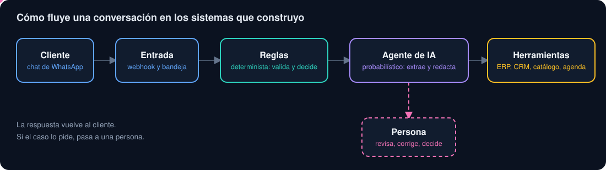
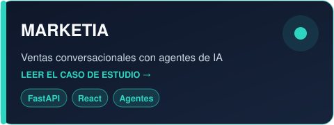
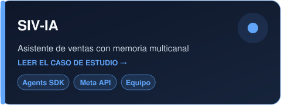
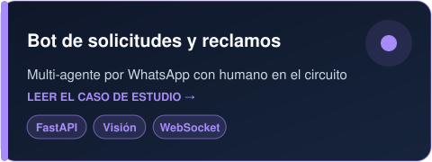
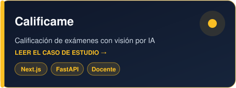
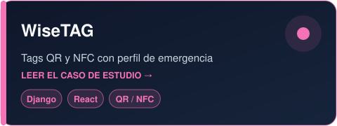
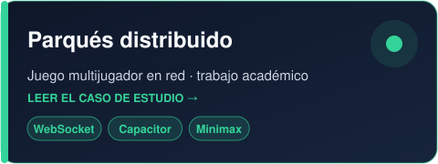
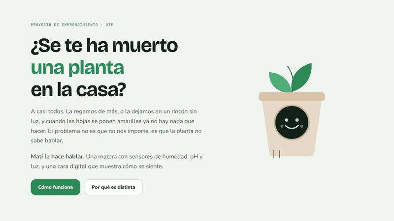

  

**Ingeniería de IA aplicada, de la idea a un sistema probado.**

Estudiante de Ingeniería de Sistemas y Computación (UTP). Construyo sistemas de IA de extremo a extremo: agentes conversacionales, asistentes de WhatsApp, visión con modelos multimodales y la ingeniería que los sostiene (API, datos, pruebas y despliegue).

## Cómo construyo sistemas de IA

  

- **Separo lo determinista de lo probabilístico.** Reglas, validaciones y derivación van por código; el modelo se usa para extraer, interpretar y redactar.
- **Humano en el circuito.** Derivación a personas, aprobación antes de aplicar cambios a un agente y el docente corrige las notas y hay un flujo de apelaciones.
- **Costo y proveedores como parte del diseño.** Medición de costo por llamada y respaldo entre proveedores de modelos.
- **Pruebo agentes antes de exponerlos.** Ejecución en sandbox con reversión, simuladores de clientes y flujos guiados con validación de la salida.
- **Despliego con cuidado.** Contenedores, CI, funciones nuevas detrás de banderas apagadas por defecto y datos separados por organización.

## Casos de estudio, de punta a punta

Cada caso recorre el problema, la arquitectura, las decisiones de diseño de IA, la ingeniería, mi rol exacto y lo que cambiaría. Describen cómo funcionan los sistemas: no publico cifras de clientes ni de uso.

<table>
  <tr>
    <td></td>
    <td></td>
  </tr>
  <tr>
    <td></td>
    <td></td>
  </tr>
  <tr>
    <td></td>
    <td></td>
  </tr>
</table>

## Stack

  
   
  
  
  

- **Backend:** Python, FastAPI, Django REST Framework, SQLAlchemy, PostgreSQL, WebSockets.
- **Frontend:** React, Next.js, TypeScript, Tailwind.
- **IA:** OpenAI (texto, visión, voz, Agents SDK), agentes con herramientas, memoria de conversación.
- **Integraciones:** WhatsApp (Meta Cloud API), Twilio (SMS y voz).
- **Calidad y despliegue:** pytest, Vitest, Playwright, Docker, nginx, Coolify, GitHub Actions.

## Proyectos públicos

**[Mati](https://github.com/DieGOD24/mati-landing)**: landing de una matera inteligente con cara de tamagotchi. Proyecto en equipo de la clase de Emprendimiento de la UTP.

  

Mi gráfica de contribuciones muestra solo una parte de mi actividad: la mayoría ocurre en repositorios privados.
