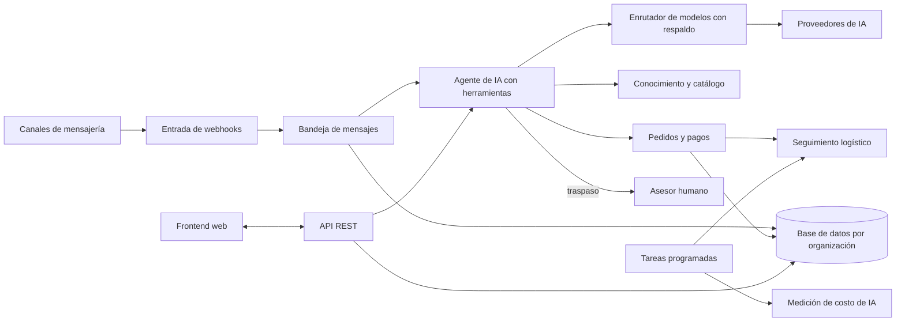

# MARKETIA: plataforma multi-organización de ventas conversacionales con agentes de IA

Plataforma SaaS diseñada para atender y vender por WhatsApp y redes sociales mediante agentes de IA, y para gestionar pedidos contraentrega y su seguimiento; backend en FastAPI y frontend en React.

## Problema

Muchos vendedores online atienden por mensajería. Responden chats, confirman pedidos contraentrega, hacen seguimiento de la entrega y miden anuncios en herramientas separadas. El proyecto reúne esas tareas en un solo sistema, con un agente de IA que conversa con el cliente y con revisión humana donde importa.

## Solución de extremo a extremo

1. Llega un mensaje por un canal conectado (WhatsApp, Messenger, Instagram, TikTok o chat web). Un webhook lo recibe, lo guarda en una bandeja y lo entrega al agente.
2. El agente responde con herramientas: busca productos en el catálogo, consulta una base de conocimiento de la organización, envía el catálogo, genera un enlace de pago o crea un pedido.
3. Si el caso lo requiere, pasa la conversación a una persona. La bandeja del frontend muestra el chat, el estado del pedido y las notas.
4. Para contraentrega, el pedido se confirma con el cliente, se calcula un puntaje de riesgo que solo sugiere, y se sigue el estado del envío a partir de los eventos de la plataforma de logística (integración de despacho apagada por defecto).
5. El panel relaciona ventas con anuncios, y los agentes se pueden probar y mejorar con ciclos de evaluación.

La integración de despacho con una plataforma de logística está detrás de banderas que nacen apagadas; no la presento como funcionalidad activa.

## Arquitectura

## Decisiones de diseño de IA

- **Agentes con herramientas y guardarraíles.** El agente de chat actúa mediante herramientas explícitas. Hay controles deterministas, como contrastar precios con el catálogo y evitar respuestas repetidas.
- **Revisión humana.** El agente puede pasar a una persona. En el ciclo de mejora, el sistema propone cambios al agente y los evalúa en seco, pero solo se aplican cuando el dueño de la organización lo confirma.
- **Respaldo entre proveedores.** El código resuelve el modelo por precedencia (agente, organización, plan, plataforma) y define una cadena de modelos de respaldo entre varios proveedores. Está implementado en código; no he medido su comportamiento en operación.
- **Medición de costo.** Cada llamada de IA registra su costo por modelo, incluidos los tokens en caché, y hay créditos por organización.
- **Pruebas en sandbox.** El agente se ejecuta con el mismo código que en producción dentro de una transacción que se revierte, sin enviar mensajes. Un simulador de clientes sintéticos tiene tope de gasto por corrida.
- **Límite conocido.** No existe una métrica agregada de calidad de los agentes; esa evaluación está pendiente.

## Ingeniería

- **Pruebas:** suites de pytest en el backend y de Vitest y Playwright en el frontend, con pruebas de paridad y pruebas de extremo a extremo opcionales con proveedor real.
- **CI/CD:** el frontend ejecuta typecheck, pruebas y build en cada PR. El workflow del backend está definido pero hoy está pausado; la puerta de calidad es un script local.
- **Despliegue:** imágenes Docker en ambos repositorios (backend con migraciones al arrancar; frontend servido con nginx).
- **Multi-organización:** los datos están modelados por organización, las agencias gestionan organizaciones hijas y los endpoints autenticados usan roles.
- **Tareas programadas:** APScheduler en el proceso, con candado de líder, para sincronizaciones, publicación programada y vigilancia de pedidos. Una cola durable sobre PostgreSQL existe como piloto, apagada por defecto.
- **Banderas:** las funciones nuevas se despliegan apagadas y se activan por plataforma u organización.

## Mi rol

Soy autor de la gran mayoría de los commits de ambos repositorios, según `git log`: más del 99 % de los commits sin merge del backend y cerca del 89 % en el frontend, contando mis alias de autor. Otras personas aportaron una fracción pequeña. Los commits miden actividad, no decisiones. El desarrollo fue asistido por IA (la mayoría de los commits llevan coautoría de un asistente).

## Lo que aprendí y qué cambiaría

- **Modularizar antes.** Hay varios módulos muy grandes. Los dividiría por dominio desde el inicio.
- **Generar clientes tipados desde OpenAPI.** Hoy los tipos del frontend se mantienen a mano y deben coincidir con los esquemas del backend. Generarlos eliminaría esa duplicación y una fuente de desajustes.
- **Medir las evaluaciones antes.** Construí sandbox, simulador y A/B antes de definir métricas de calidad. Definiría primero un conjunto de evaluación y una línea base.
- **Migración inicial y cola.** Crearía una migración inicial completa y adoptaría la cola durable desde el principio, en lugar de tareas en proceso.

Estado: describo cómo funciona; no afirmo clientes ni uso.

## Stack

Python 3.12, FastAPI, SQLAlchemy asíncrono, Alembic, PostgreSQL, APScheduler, Pydantic; React 18, TypeScript, Vite, Vitest, Playwright; Docker, nginx, GitHub Actions; múltiples proveedores de LLM, voz y APIs de mensajería.
