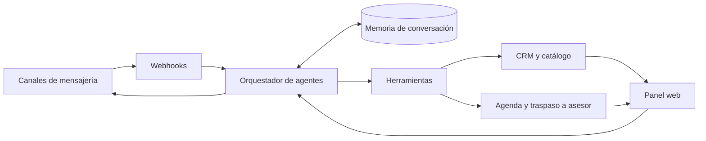

# SIV-IA: asistente de ventas con agentes de IA sobre canales de mensajería

Plataforma multi-empresa en la que agentes de IA están diseñados para atender a clientes por WhatsApp, Messenger e Instagram y llevarlos hasta una venta o una cita, con un panel web para el equipo comercial.

## Problema

Las empresas que venden por mensajería responden tarde, pierden el contexto entre conversaciones y dependen de que un asesor recuerde qué se prometió. Un chatbot genérico no basta: necesita memoria, catálogo y acciones reales (agendar, consultar, pasar a una persona), sin prometer lo que no puede hacer.

## Solución de extremo a extremo

El cliente escribe por WhatsApp, Messenger o Instagram. El mensaje llega por webhook, se agrupa si el cliente escribe en ráfagas y se asocia a una conversación de su empresa. Un agente responde con el historial, el resumen y el catálogo de esa empresa. Si hace falta, ejecuta una herramienta: agendar una cita, consultar datos, enviar material o trasladar la conversación a un asesor, que puede tomar el control desde el panel. La conversación queda registrada en el CRM, y las campañas y los reportes se gestionan desde la misma aplicación.

SIV-IA nació de un prototipo mínimo, con un único endpoint sin estado, y creció hasta ser una plataforma multi-empresa.

## Arquitectura

## Decisiones de diseño de IA

- **Agentes con OpenAI Agents SDK**, con agentes distintos por función y configuración por empresa. Cada turno tiene tiempo máximo y un reintento ante errores transitorios.
- **Memoria persistente**: historial por conversación y canal, resumen y un estado estructurado por conversación, con opción de reinicio.
- **Conocimiento**: búsqueda en documentos de la empresa y bloque de catálogo en el contexto.
- **Herramientas reales** para agendar, trasladar a un humano, consultar datos y enviar material, de modo que el agente actúe en lugar de solo anunciar.
- **Flujos guiados**: para casos donde la respuesta debe seguir un guion, un enrutador elige el guion del turno y un validador revisa la salida, por ejemplo rechazando promesas sin acción detrás. Este diseño se apoyó en el análisis de transcripciones de ejemplo.
- **Evaluación**: conjuntos de referencia, un juez basado en LLM y reproducción de conversaciones, además del registro de uso y coste de modelos por llamada.

## Ingeniería

- Más de 4.000 funciones de prueba en el backend (conteo estático), con base de datos real en pruebas y servicios externos simulados. También hay pruebas que verifican el aislamiento entre empresas.
- CI con formato y orden de imports obligatorios, análisis estático, construcción de la imagen y comprobación de salud del servicio.
- Frontend con pruebas unitarias de utilidades y pruebas e2e con Playwright sobre una API simulada. La CI del frontend comprueba lint, compilación y una auditoría de calidad de React.
- Despliegue en contenedores, dependencias fijadas y tareas en segundo plano para sincronizaciones y campañas.
- Multi-empresa: cada dato pertenece a una empresa, con roles y activación de funciones por empresa.

## Mi rol

SIV-IA es un producto de equipo con otros dos autores. Soy uno de los principales autores del backend (alrededor del 77 % de los commits sin merge) y de la mitad del frontend. Según el historial, mi trabajo se concentró en servicios del backend, el motor de respuesta por canal, los flujos guiados, la evaluación y la integración de canales. Desarrollé con asistentes de IA y los commits lo registran.

## Lo que aprendí y qué cambiaría

- Un validador de salida es más fácil de probar que una instrucción más larga en el prompt.
- Simular el ejecutor de agentes en las pruebas puede ocultar fallos reales. Hoy prefiero pruebas de contrato y evaluaciones con el modelo real.
- Un módulo de respuesta por canal creció demasiado. Lo dividiría pronto en piezas con interfaces claras.
- Usaría migraciones versionadas desde el inicio, una cola externa para tareas en segundo plano y acceso asíncrono a la base de datos.

Estado: describo cómo funciona; no afirmo clientes ni uso.

## Stack

Python, FastAPI, SQLAlchemy, PostgreSQL, OpenAI Agents SDK, Meta Cloud API, Docker, GitHub Actions, pytest, Next.js, React, TypeScript, Tailwind, Playwright, Vitest.
